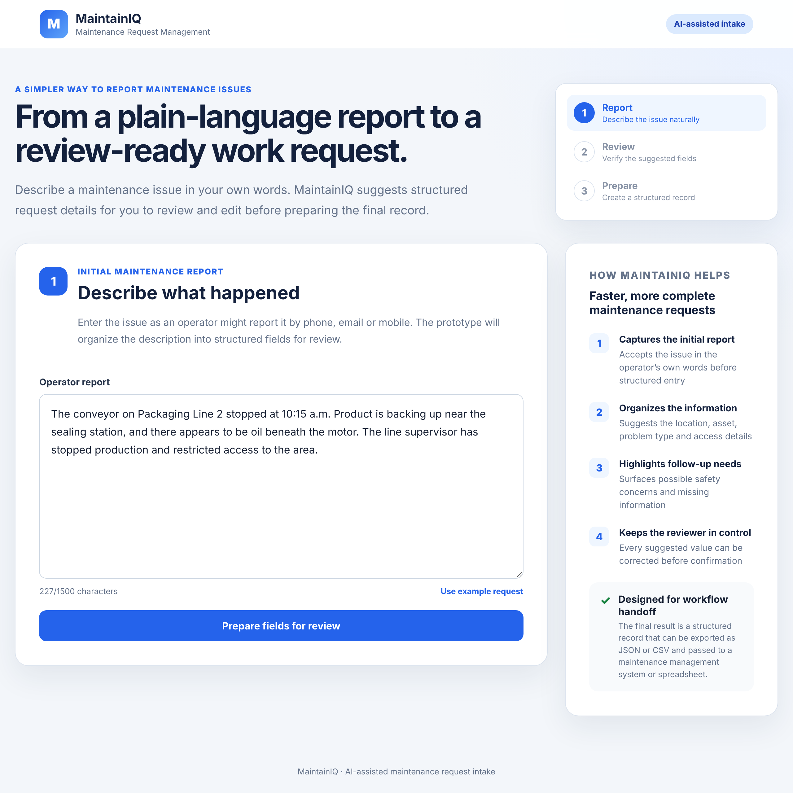
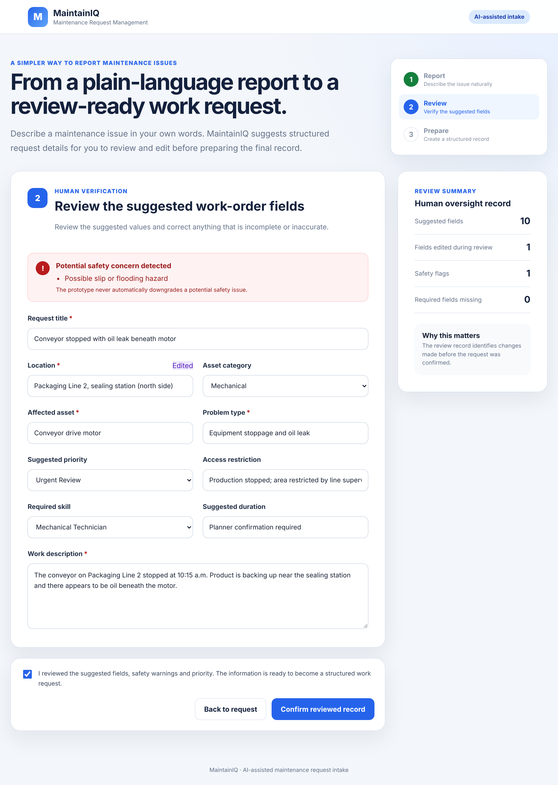
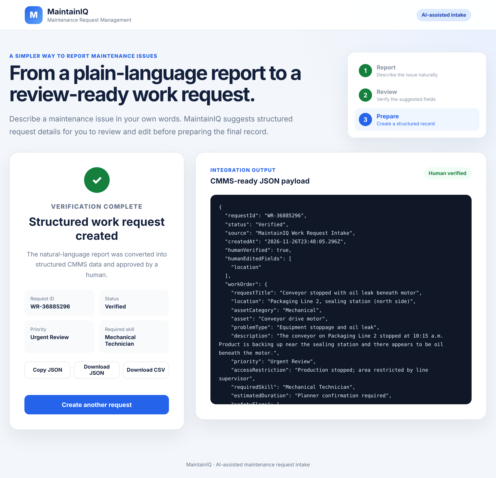
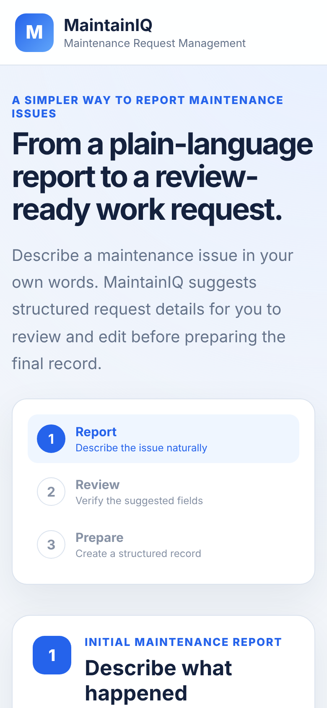
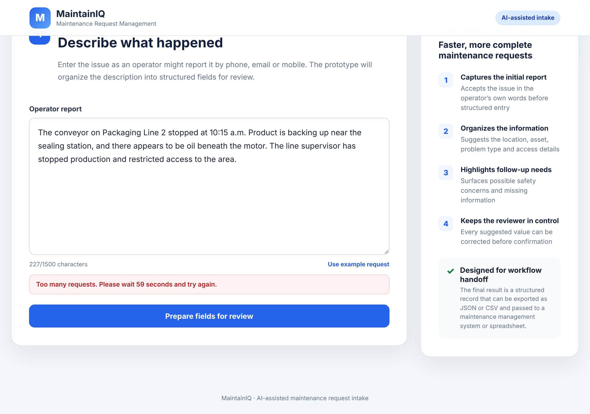

# MaintainIQ Intake

[](https://github.com/bharathgopalswamy/maintainiq-intake/actions/workflows/ci.yml)

MaintainIQ Intake turns a plain-language maintenance report into structured, reviewed work-request fields that are ready to hand off to a maintenance team, spreadsheet or maintenance management system (CMMS).

The application uses Gemini to extract relevant information, applies deterministic safety checks, validates the resulting structure and requires a person to review the information before preparing the final record.

## Screenshots

| 1. Plain-language report | 2. Human review |
|---|---|
|  |  |

| 3. Verified record with JSON/CSV export | Mobile |
|---|---|
|  |  |

| Rate-limit message (429) |
|---|
|  |

Screenshots 01–04 were captured from the production build with the Gemini call replaced by a fixed, fictional response. Screenshot 05 was captured from the production server with `RATE_LIMIT_MAX=1` after one earlier request.

## Project objective

Maintenance issues may initially be communicated through speech, phone calls, email, mobile messages or unstructured descriptions.

For example:

> The conveyor on Packaging Line 2 stopped at 10:15 a.m. Product is backing up near the sealing station, and there appears to be oil beneath the motor.

Before this information can be used effectively in a CMMS, it may need to be organized into fields such as:

- Request title
- Location
- Asset and asset category
- Problem type
- Work description
- Suggested priority
- Access restrictions
- Required maintenance skill
- Potential safety concerns
- Missing information

This prototype explores whether preparing those fields automatically could support an existing structured work-request process.

It does not attempt to replace a CMMS, maintenance planner or existing work-order workflow.

## Core workflow

1. An operator enters a maintenance issue in their own words.
2. The React application sends the description to the Express API.
3. The Express server sends the report to Gemini.
4. Gemini extracts the information into a predefined JSON structure.
5. Zod validates the returned fields and permitted values.
6. Deterministic safety rules independently inspect the original report.
7. The application displays the prepared fields for human review.
8. The reviewer can correct or complete the information.
9. After confirmation, the application produces a structured record that can be copied or downloaded as JSON or CSV.

```text
Plain-language report
        ↓
Gemini field extraction
        ↓
Schema validation
        ↓
Deterministic safety checks
        ↓
Human review and correction
        ↓
Structured work-request payload
        ↓
JSON / CSV export
```

## Features

### Plain-language intake

Users can report a maintenance problem without first understanding every CMMS field or maintenance classification.

### Structured field preparation

The application prepares fields including:

- Request title
- Location
- Asset category
- Affected asset
- Problem type
- Description
- Suggested priority
- Access restrictions
- Required maintenance skill
- Suggested duration
- Safety flags
- Missing information

### Human verification

The extracted information is never submitted automatically.

The reviewer can:

- Correct inaccurate suggestions
- Complete missing fields
- Change the category or priority
- Review potential safety concerns
- Confirm the final structured record

### Safety checks

Safety identification does not depend entirely on the language model.

The backend also uses deterministic rules to detect terms related to:

- Fire or smoke
- Gas leaks
- Electrical hazards
- Slippery or flooded areas
- Trapped occupants
- Injuries or unsafe conditions
- Hazardous materials

When a possible safety concern is detected, the record is marked for urgent human review.

### Rate limiting and structured logging

- `POST /api/intake/analyze` allows a fixed number of requests per client per time window (default 10 per minute, configurable). Over the limit, the API returns `429 Too Many Requests` with a `Retry-After` header, and Gemini is never called, so no AI quota is used.
- Every response carries `RateLimit-Limit`, `RateLimit-Remaining` and `RateLimit-Reset` headers.
- The intake screen tells the user exactly how many seconds to wait.
- Every API request gets an ID, returned in the `X-Request-Id` header and written to a one-line JSON log entry (method, path, status, duration). If a user reports a problem, the ID finds the matching log lines.
- Logs only contain allow-listed fields. The maintenance report text, request bodies, headers and API keys are never logged.

### Structured output and export

After verification, the application prepares a JSON payload that demonstrates how the information could eventually be mapped to an approved CMMS API or configured workflow.

The verified record can be:

- **Copied as JSON** (with a confirmation message, or a fallback message if the browser blocks clipboard access)
- **Downloaded as JSON** — `WR-xxxxxxxx.json`, for an API-style integration
- **Downloaded as CSV** — `WR-xxxxxxxx.csv`, one header row and one data row (17 columns), for a spreadsheet or a CMMS bulk-import screen

The CSV follows RFC 4180 quoting (commas, quotes and line breaks are escaped) and protects against spreadsheet formula injection by prefixing cells that start with `=`, `+`, `-` or `@`. Files are generated in the browser; nothing is stored on a server.

No real CMMS record is created by this prototype.

## Example

### Input

```text
The air conditioner in Room 204 stopped cooling this morning.
It is making a loud noise, and water is making the floor slippery.
Students are using the room until 3 p.m.
```

### Prepared information

```json
{
  "requestTitle": "Air conditioner cooling failure and water leak",
  "location": "Room 204",
  "assetCategory": "HVAC",
  "asset": "Air conditioner",
  "problemType": "Cooling failure and water leak",
  "description": "The air conditioner stopped cooling, is making a loud noise, and is leaking water.",
  "suggestedPriority": "Urgent Review",
  "accessRestriction": "Students are using the room until 3 p.m.",
  "requiredSkill": "HVAC Technician",
  "suggestedDuration": "Planner confirmation required",
  "safetyFlags": [
    "Possible slip or flooding hazard"
  ],
  "missingFields": []
}
```

## Technology stack

### Frontend

- React
- JSX
- Vite
- CSS
- Vitest, React Testing Library

### Backend

- Node.js
- Express
- Gemini API
- Zod
- dotenv

### Deployment

- GitHub for source control
- Render for the React production build and Express API

## Architecture

See [docs/ARCHITECTURE.md](docs/ARCHITECTURE.md) for the component diagram, data model and key design decisions.

```text
Browser
  └── React interface
        └── POST /api/intake/analyze
              └── Express server
                    ├── Gemini extraction
                    ├── Zod validation
                    └── Safety rules
                          └── Structured response
                                └── Human review screen
```

## Project structure

```text
maintainiq-intake/
├── .github/workflows/ci.yml     # Lint, test, build and Docker build on every push/PR
├── docs/
│   ├── ARCHITECTURE.md
│   └── screenshots/
├── public/
├── shared/
│   └── workRequestOptions.js    # Allowed categories, priorities and skills (server + browser)
├── server/
│   ├── __tests__/               # Vitest + Supertest tests
│   ├── app.js                   # Express app (routes), created without listening
│   ├── index.js                 # Starts the server
│   ├── logger.js                # JSON logging + request-ID middleware
│   ├── rateLimiter.js           # Per-client fixed-window rate limiter
│   ├── validation.js            # Input checks before calling the AI model
│   ├── geminiService.js
│   ├── safetyRules.js
│   └── workRequestSchema.js
├── src/
│   ├── components/
│   │   ├── WorkRequestIntake.jsx
│   │   ├── WorkOrderReview.jsx
│   │   └── WorkRequestSuccess.jsx
│   ├── services/
│   │   └── intakeService.js
│   ├── utils/
│   │   └── exportWorkRequest.js # JSON/CSV export
│   ├── __tests__/               # React Testing Library + export tests
│   ├── test/                    # Test setup and fictional fixtures
│   ├── App.jsx
│   ├── index.css
│   └── main.jsx
├── Dockerfile
├── DEVLOG.md
├── index.html
├── package.json
├── vitest.config.js
└── vite.config.js
```

## Local setup

### Requirements

- Node.js 20 or newer
- npm
- Gemini API key

### Installation

Clone the repository:

```bash
git clone https://github.com/bharathgopalswamy/maintainiq-intake.git
cd maintainiq-intake
```

Install the dependencies:

```bash
npm install
```

Create a `.env` file in the project root:

```env
GEMINI_API_KEY=your_gemini_api_key
GEMINI_MODEL=gemini-3.6-flash
PORT=3001
```

Optional settings:

| Variable | Default | Purpose |
|---|---|---|
| `RATE_LIMIT_MAX` | `10` | Analyze requests allowed per client per window |
| `RATE_LIMIT_WINDOW_MS` | `60000` | Window length in milliseconds |
| `TRUST_PROXY` | unset | Number of reverse proxies in front of the app. Set to `1` on Render or behind a load balancer so each user is limited by their own IP instead of the proxy's |

Do not add quotes around the API key.

Do not commit the `.env` file.

### Development

Start the React frontend and Express backend together:

```bash
npm run dev
```

Development addresses:

```text
Frontend: http://localhost:5173
Backend:  http://localhost:3001
Health:   http://localhost:5173/api/health
```

### Production test

Create the React production build:

```bash
npm run build
```

Start Express:

```bash
npm start
```

Open:

```text
http://localhost:3001
```

In production mode, Express serves both the React application and the API.

## API

### Health check

```http
GET /api/health
```

Example response:

```json
{
  "status": "ok",
  "geminiConfigured": true
}
```

### Analyze a maintenance report

```http
POST /api/intake/analyze
Content-Type: application/json
```

Request body:

```json
{
  "description": "The conveyor on Packaging Line 2 stopped and there appears to be oil beneath the motor."
}
```

The endpoint returns schema-validated work-request fields for review.

Responses:

| Status | Meaning |
|---|---|
| `200` | Structured fields for review |
| `400` | Missing, too short, too long or malformed (non-JSON) input |
| `413` | Request body over 20 kB |
| `429` | Too many requests from this client (`Retry-After` header and `retryAfterSeconds` in the body), or the Gemini quota is exhausted |
| `502` | The model call or its output failed; details stay in the server log |
| `503` | No Gemini API key configured |

Every API response includes an `X-Request-Id` header. Example log line:

```json
{"time":"2026-11-27T23:47:21.317Z","level":"warn","event":"request.completed","requestId":"6598b8ed-cd72-4c8b-b0d2-366b2347d8b7","method":"POST","path":"/api/intake/analyze","status":429,"durationMs":1}
```

## Available commands

```bash
npm run dev
```

Runs the Vite development server and Express API together.

```bash
npm run dev:client
```

Runs only the Vite frontend.

```bash
npm run dev:server
```

Runs only the Express backend with file watching.

```bash
npm run build
```

Creates the production React build in `dist`.

```bash
npm start
```

Starts the production Express server.

```bash
npm run preview
```

Previews the Vite build without the production Express API.

```bash
npm test
```

Runs both test projects with Vitest: the server suite (Supertest, Node) and the client suite (React Testing Library, jsdom). The tests replace the Gemini call and `fetch` with fakes, so no API key or network access is needed.

```bash
npm run lint
```

Runs ESLint on the frontend and server code.

## Testing

100 automated tests in two Vitest projects (59 server, 41 client).

The server tests cover:

- Input validation (missing, non-text, too short and too long descriptions)
- Deterministic safety rules, including whole-word matching so `firewall` is not treated as a fire hazard
- Parsing of model output wrapped in Markdown fences or extra text
- Schema validation of the structured work request
- API behaviour for success, missing configuration (503), provider rate limits (429) and model failures (502 without leaking internal error details)
- Rate limiter: limit and remaining headers, 429 with `Retry-After`, window reset, separate clients, memory clean-up, `TRUST_PROXY` handling (a client cannot dodge the limit by inventing an `X-Forwarded-For` address)
- Logging: JSON format, field allow-list (report text and keys are dropped), request IDs (generated, or reused only if safe), log levels by status, malformed JSON (400) and oversized body (413)

The client tests cover:

- Intake: short-report validation, example request, successful analysis, friendly error on failure, "wait N seconds" message on 429
- API client: error status and `Retry-After` handling
- Review: pre-filled values, required-field blocking, mandatory confirmation checkbox, "Edited" tracking, payload contents, and a regression test for the dropdown options
- Verified record: summary, JSON/CSV downloads, clipboard success and failure messages
- Export utilities: CSV quoting, list joining, formula-injection protection, safe file names, download mechanics
- The full intake → review → verified flow with the network call faked

## Docker

```bash
docker build -t maintainiq-intake .
docker run -p 3001:3001 -e GEMINI_API_KEY=your_key maintainiq-intake
```

The image uses a two-stage build: the first stage compiles the React app, the second contains only production dependencies, the server and the built files, and runs as a non-root user.

## Render deployment

Create a Render Web Service connected to the GitHub repository.

Use:

```text
Build command:
npm install --include=dev && npm run build

Start command:
npm start
```

Add the following environment variables through the Render dashboard:

```text
GEMINI_API_KEY
GEMINI_MODEL
TRUST_PROXY=1
```

`TRUST_PROXY=1` makes the rate limiter use each visitor's real IP (Render runs the app behind a proxy).

Render supplies the `PORT` environment variable automatically.

Do not upload the local `.env` file.

## Security and reliability approach

The prototype includes several controls:

- Gemini API key remains on the server.
- Browser code never receives the API key.
- Request length is limited.
- Gemini output is parsed and schema-validated.
- Only permitted categories and priority values are accepted.
- Unknown information should remain blank instead of being invented.
- Safety language is checked separately from Gemini.
- Human verification is required before preparing the record.
- The analyze endpoint is rate-limited per client (429 + `Retry-After`).
- Logs are structured JSON with request IDs; report text and keys are never logged, and internal error details are never returned to the browser.
- Automated tests and CI run on every push and pull request.

A production implementation would additionally require:

- Authentication
- Role-based access control
- A shared rate-limit store (e.g. Redis) if more than one server instance runs
- Audit logging
- Secure data storage
- Privacy and retention policies
- Customer-specific asset and priority rules
- Monitoring and error reporting

## Current limitations

This is a portfolio project.

It currently:

- Uses fictional maintenance data
- Does not create a real CMMS work order
- Does not store records in a database
- Does not include user authentication
- Does not know a facility's real asset hierarchy
- Does not replace a maintenance planner
- Has not been tested with real maintenance teams

The suggested priority is a starting point for human review, not an operational authorization.

## Possible next steps

A fuller version could:

1. Map prepared fields to an approved CMMS data model.
2. Load customer-specific locations and assets.
3. Apply configured priority and criticality rules.
4. Authenticate users and apply role-based access.
5. Send the reviewed payload to a maintenance system through its API.
6. Record the original report, prepared values and human changes.
7. Measure completion time, corrections and request quality.

These are possible future directions, not current capabilities.

## Purpose of the project

This project was created to demonstrate:

- Requirements analysis
- React interface development
- Node and Express API development
- Third-party API integration
- Structured-data validation
- Error handling
- Safety-aware business rules
- Human-in-the-loop application design
- Understanding of CMMS work-request workflows

## How this was built

The original application (React interface, Express server, Gemini integration, schema and safety rules) was built by Bharath Gopalsamy.

Later improvements — the test suites, CI, Docker, the server refactor, the JSON/CSV export, rate limiting and structured logging — were implemented with AI assistance (Claude) on feature branches and opened as pull requests that Bharath reviews and merges. Commits made this way carry a `Co-Authored-By: Claude` line, and [DEVLOG.md](DEVLOG.md) explains each change so it can be understood and maintained.

## Disclaimer

This is a personal portfolio project created by Bharath Gopalsamy. All examples use fictional maintenance data.

## Author

**Bharath Gopalsamy**

Master of Applied Computer Science graduate  
Application Developer and Application Support professional

- GitHub: [bharathgopalswamy](https://github.com/bharathgopalswamy)
- LinkedIn: [Bharath Gopalsamy](https://www.linkedin.com/in/bharathgopalsamy/)
