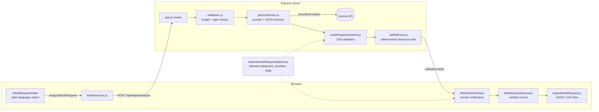

# Architecture

MaintainIQ Intake is a single deployable Node.js service: Express serves both the
JSON API and the built React app. There is no database; each request is processed
and returned, and the verified record exists only in the browser until it is
exported.

## Overview



## Request lifecycle

1. **Intake** — the operator types a report (15–1,500 characters). The browser checks the minimum length before calling the API.
2. **Validation** — `validation.js` rejects missing, non-text, too-short or too-long input with `400` before any AI call is made.
3. **Extraction** — `geminiService.js` sends the report to Gemini with a JSON response schema generated from the Zod schema, then parses the reply (tolerating Markdown fences).
4. **Schema check** — `workRequestSchema.js` rejects any output whose categories, priorities or skills are not in the allowed lists.
5. **Safety rules** — `safetyRules.js` scans the *original* report with whole-word patterns. Any hit adds a flag and forces priority to `Urgent Review`, regardless of what the model said.
6. **Human review** — `WorkOrderReview` pre-fills an editable form, tracks which fields the reviewer changed, blocks confirmation while required fields are empty, and requires an explicit "I reviewed" checkbox.
7. **Verified record and export** — `WorkRequestSuccess` shows the final payload. `exportWorkRequest.js` turns it into a JSON file (for an API integration) or a one-row CSV (for a spreadsheet or a CMMS bulk-import screen). Files are generated in the browser; nothing is sent to a server.

## Components

| Layer | File | Responsibility |
|---|---|---|
| Shared | `shared/workRequestOptions.js` | Single list of allowed categories, priorities and skills, used by the Zod schema and the review dropdowns |
| Server | `server/app.js` | App factory (`createApp`) with injectable analyzer, health check, analyze route, static files, JSON 404 |
| Server | `server/validation.js` | Input checks before the AI call |
| Server | `server/geminiService.js` | Prompt, Gemini call, response parsing |
| Server | `server/workRequestSchema.js` | Zod schema + JSON schema for Gemini structured output |
| Server | `server/safetyRules.js` | Deterministic safety keywords; can only raise priority, never lower it |
| Client | `src/services/intakeService.js` | `fetch` wrapper that turns non-2xx responses into errors |
| Client | `src/components/*` | Three steps: intake, review, verified record |
| Client | `src/utils/exportWorkRequest.js` | CSV/JSON conversion, CSV-injection protection, browser download |

## Data model

The API returns the **analysis** (what the model suggested, after schema and safety checks):

| Field | Type | Notes |
|---|---|---|
| `requestTitle`, `location`, `asset`, `problemType`, `description` | string | Empty string when not stated |
| `assetCategory` | enum | `shared/workRequestOptions.js` |
| `suggestedPriority` | enum | `Urgent Review` whenever a safety flag exists |
| `requiredSkill` | enum | |
| `accessRestriction`, `suggestedDuration` | string | |
| `safetyFlags`, `missingFields` | string[] | |

After review, the browser builds the **verified record**:

```json
{
  "requestId": "WR-12345678",
  "status": "Verified",
  "source": "MaintainIQ Work Request Intake",
  "createdAt": "ISO-8601 timestamp",
  "humanVerified": true,
  "humanEditedFields": ["location"],
  "workOrder": { "requestTitle": "...", "priority": "...", "safetyFlags": [] }
}
```

The CSV export flattens this into 17 columns (`CSV_COLUMNS` in `exportWorkRequest.js`); lists are joined with `; `.

## Key decisions

| Decision | Why |
|---|---|
| Safety rules run outside the model | A language model can miss a hazard; keyword rules are predictable and testable. They can only escalate. |
| Human confirmation is mandatory | The model's output is a suggestion. The record is only marked `Verified` after a person reviews it. |
| Allowed values live in one shared module | The review dropdowns were missing "Fire and Life Safety", so a valid server value displayed as a different option. One source of truth prevents that drift. |
| Export happens in the browser | No database or storage is needed; the verified record never leaves the user's machine unless they choose to download it. |
| CSV cells starting with `= + - @` are prefixed with `'` | Prevents spreadsheet formula injection from user-entered text (OWASP "CSV injection"). |
| `createApp()` factory with injected analyzer | Tests run without a Gemini key or network. |
| Generic error messages to the browser | Internal errors are logged server-side; users never see stack traces or provider details. |

## Testing

| Suite | Environment | Covers |
|---|---|---|
| `server/__tests__` | Node | Input validation, safety rules, model-output parsing, schema, API status codes |
| `src/__tests__` | jsdom + React Testing Library | Each screen's behaviour, export utilities, and the full intake → review → verified flow with `fetch` faked |

Both run with `npm test` (Vitest projects) and in GitHub Actions on every push and pull request.

## Not yet implemented

Rate limiting, structured logging, authentication, persistent storage and a real CMMS integration. See the README's limitations section.
